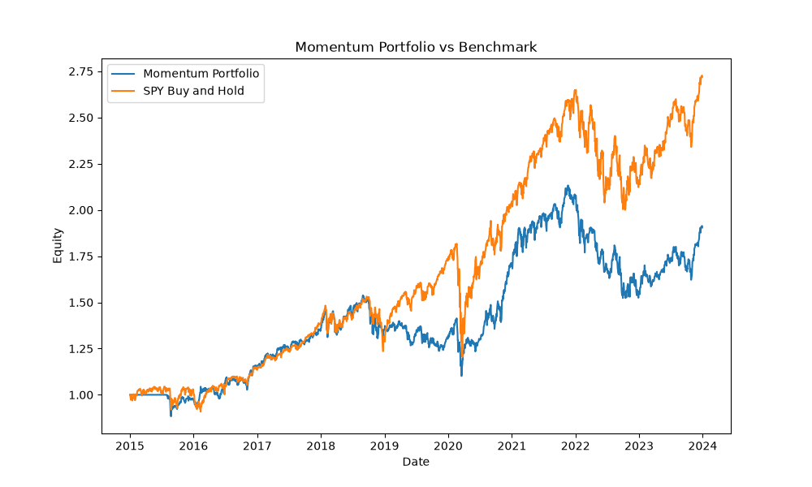
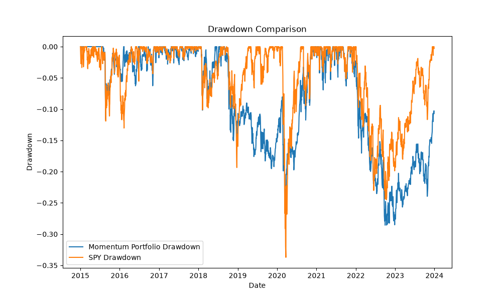

# Multi-Asset Momentum Backtest

A Python backtesting project for a multi-asset momentum portfolio strategy.

## Project Overview

This project builds a multi-asset momentum portfolio backtesting system.

The strategy selects the strongest assets based on past momentum and rebalances the portfolio monthly.

## Asset Universe

The strategy uses the following ETFs:

- SPY: S&P 500 ETF
- QQQ: Nasdaq 100 ETF
- IWM: Russell 2000 ETF
- TLT: Long-Term Treasury ETF
- GLD: Gold ETF

## Strategy Logic

The strategy follows these steps:

1. Download historical ETF price data
2. Calculate 126-day momentum for each asset
3. Rank assets by momentum
4. Select the top 2 assets
5. Allocate equal weight to selected assets
6. Rebalance at month-end and let holdings drift with market returns between rebalances
7. Apply 0.10% transaction costs per unit of traded notional
8. Compare performance against SPY buy-and-hold

Signals use the current month's last available closing prices, and the resulting
target weights affect **subsequent** close-to-close returns. Trading is modeled
at that same month's closing price, which is a simplified execution assumption:
in practice, a signal calculated after the close would require next-session
execution and could incur additional slippage. The portfolio is in cash until
it has 126 days of lookback history. The SPY benchmark is continuously invested
over the full sample, so the two allocations have different exposure during
this initial warm-up period.

## Tools Used

- Python
- pandas
- numpy
- matplotlib
- yfinance

## How to Run

Install dependencies:

```bash
pip install -r requirements.txt
```

Run the backtest:

```bash
python src/backtest.py
```

Run the regression tests:

```bash
python -m unittest discover -s tests -v
```

## Performance Summary

| Metric | Momentum Portfolio | SPY Benchmark |
|---|---:|---:|
| Total Return | 90.48% | 171.91% |
| CAGR | 7.43% | 11.77% |
| Volatility | 14.93% | 18.09% |
| Sharpe Ratio | 0.56 | 0.71 |
| Max Drawdown | -28.57% | -33.72% |
| Calmar Ratio | 0.26 | 0.35 |

These values were regenerated on November 19, 2026, using adjusted prices
downloaded from Yahoo Finance for January 2015 through December 2023 (the
configured end date, January 1, 2024, is exclusive). Annualization assumes
252 trading days, Sharpe is calculated with a zero risk-free rate, and the
strategy includes the configured trading costs. Data-provider revisions can
change figures when the backtest is rerun.

The momentum strategy returned less than a continuously invested SPY
benchmark over this period, but exhibited lower annualized volatility and a
smaller maximum drawdown. This is a historical backtest, not a guarantee of
future performance.

**Correction:** Earlier reported performance was inflated because forward
filling zero portfolio weights kept previously sold ETFs in the portfolio,
occasionally producing 250% total target exposure. The corrected signal
generator replaces the entire target-weight row at each rebalance, and the
portfolio engine now calculates returns and turnover from actual drifting
holdings. Regression tests guard against both bugs.

## Results

### Equity Curve



### Drawdown



## Output Files

The project generates:

- `results/equity_curve.png`
- `results/drawdown.png`
- `results/weights.csv` (daily **target** weights, not drifted holdings)
- `results/backtest_results.csv`
- `results/performance_report.csv`

## Performance Metrics

The project calculates:

- Total Return
- CAGR
- Volatility
- Sharpe Ratio
- Maximum Drawdown
- Calmar Ratio

## Disclaimer

This project is for educational purposes only. It is not financial advice.
